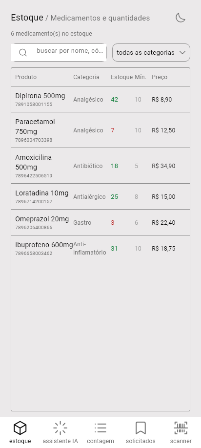
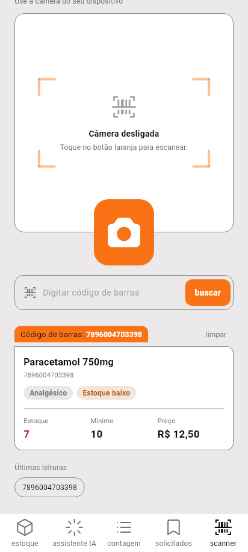
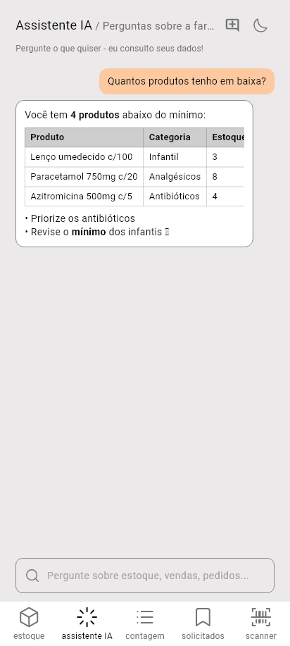
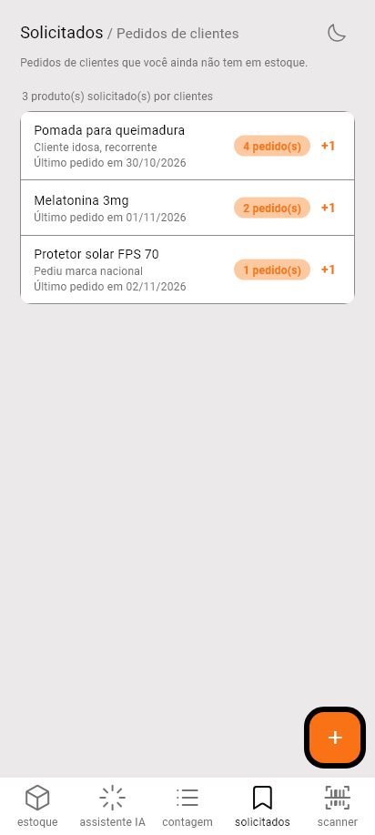

# auraFarma — app celular

App Android/iOS (Flutter) do **auraFarma**, o sistema de estoque e compliance para farmácias pequenas.
Mostra **estoque, assistente de IA, contagem, solicitados e scanner de código de barras**, com os mesmos
dados do site: você entra com a mesma conta e o que muda num lado aparece no outro.

| Estoque | Scanner | Assistente IA | Contagem | Solicitados |
|---|---|---|---|---|
|  |  |  |  |  |

> **Está começando em Flutter?** Leia o [GUIA_FLUTTER.md](GUIA_FLUTTER.md): explica em português simples os
> conceitos usados aqui (widget, `setState`, `async/await`, estado global...). Todo arquivo `.dart` também
> começa com um bloco "O QUE É ESTE ARQUIVO", e cada classe, função e passo importante tem comentário.

> Estas imagens são renders de teste (`test_visual/`), gerados sem celular.
> Design de origem: Figma "Untitled" (referências em `design/figma/`).

---

## Como as peças se encaixam

```
┌────────────────────┐        HTTPS         ┌──────────────────────────┐      ┌───────────────┐
│  App celular       │ ───────────────────► │  Backend (Node/Express)  │ ───► │   MongoDB     │
│  (Flutter)         │   cookie de sessão   │  porta 4000, rotas /api  │      │ (Atlas/local) │
│  ESTE repositório  │                      │  repo: aura-farma        │ ───► │  OpenRouter   │
└────────────────────┘                      └──────────────────────────┘      │ (IA; a chave  │
         ▲                                              ▲                     │ fica no server)│
         │ túnel (só se o celular                       │                     └───────────────┘
         │ não está na sua rede, ex. 4G)    ┌───────────┴──────────────┐
┌────────┴───────────┐                      │  Site (React + Vite)     │
│  cloudflared       │                      │  porta 5173              │
└────────────────────┘                      │  repo: aura-farma        │
                                            └──────────────────────────┘
```

São **dois repositórios**:

| Repositório | O que tem |
|---|---|
| **este** (`aura-farma-app`) | o app Flutter + scripts que sobem o servidor com um comando |
| [`akira113p/aura-farma`](https://github.com/akira113p/aura-farma) | o **backend** (API) e o **site** |

### Por que existe uma API (e por que o 4G precisa de túnel)

- O app é só a **tela**. Os dados ficam no MongoDB, e só o backend fala com o banco. O app nunca recebe a
  senha do banco nem a chave da IA: elas ficam no servidor.
- No **mesmo computador** o app acessa o backend por `localhost`. O **celular** é outro aparelho e precisa
  alcançar o PC pela rede. No mesmo Wi-Fi basta o IP do PC (e liberar a porta no firewall). No **4G** o celular
  está fora da sua rede e o PC não é visível da internet. Por isso o script abre um **túnel**
  (`cloudflared`, gratuito e sem conta): ele dá um endereço `https://...trycloudflare.com` que leva ao seu PC.

---

## Início rápido: Linux + celular no 4G

### 1. O que instalar no PC (uma vez)

```bash
sudo apt update && sudo apt install -y git curl nodejs npm   # o Node precisa ser 20 ou mais novo
node -v                                                       # confira: v20+
```
Se o Node do `apt` for velho, instale o 20+ por <https://nodejs.org> ou com `nvm`.

Você também precisa de um **MongoDB**. O mais fácil é um [MongoDB Atlas](https://www.mongodb.com/atlas) gratuito
(copie a URI `mongodb+srv://...`). Alternativa local: `docker run -d -p 27017:27017 mongo:7` e use
`mongodb://127.0.0.1:27017/aurafarma`.

### 2. Subir o servidor (com túnel)

```bash
git clone https://github.com/akira113p/aura-farma-app.git
cd aura-farma-app
./scripts/rodar-servidor.sh
```

O script faz tudo sozinho:
1. baixa o backend (`akira113p/aura-farma`) para `./aura-farma/`;
2. instala as dependências;
3. na 1ª vez pergunta a URI do MongoDB e a chave do OpenRouter e cria o `.env` (fora do git, com um
   `SESSION_SECRET` aleatório);
4. sobe o backend na porta 4000 e espera ele responder;
5. baixa o `cloudflared` (pergunta antes) e abre o túnel;
6. imprime o endereço para usar no app:

```
 Endereço para o app (celular no 4G):
     https://alguma-coisa-aleatoria.trycloudflare.com
```

Deixe esse terminal aberto. `Ctrl+C` para tudo. O endereço **muda toda vez** que o script reinicia.
Opções: `--web` (sobe também o site em <http://localhost:5173>) e `--sem-tunel` (só o backend, para o mesmo Wi-Fi).

### 3. Criar sua conta

O app só faz **login**. O cadastro é no site (`./scripts/rodar-servidor.sh --web`, depois abra
<http://localhost:5173>) ou por linha de comando:

```bash
curl -X POST http://localhost:4000/api/auth/register -H 'Content-Type: application/json' \
  -d '{"username":"ana","pharmacyName":"Farmácia Ana","email":"ana@exemplo.com","password":"Senha-forte1!"}'
```
A senha precisa de 8+ caracteres com letra, número e símbolo.

### 4. Colocar o app no celular

Precisa do **APK** (Android). Para gerá-lo você precisa do Flutter e do Android SDK (veja "Instalar Flutter no
Linux" abaixo). Depois:

```bash
./scripts/build-apk.sh
adb install -r build/app/outputs/flutter-apk/app-release.apk   # celular no USB, depuração USB ligada
```
Ou copie o `.apk` para o celular e abra (permita "instalar apps desconhecidos").
Dá para gerar o APK em outro computador e só instalar no celular: o APK **não** guarda o endereço do servidor.

### 5. Apontar o app para o seu servidor

No app, na tela de login, toque em **"Servidor: ..."** (embaixo), cole o endereço do túnel e toque em
**salvar**. Entre com a sua conta. Na aba **estoque** use **"popular com exemplos"** para ter dados de teste.

Quando o túnel mudar (você reiniciou o script), repita só este passo. Não precisa gerar o APK de novo.

---

## Cada parte separada

### Backend (repo `aura-farma`, pasta `backend/`)

```bash
git clone https://github.com/akira113p/aura-farma.git && cd aura-farma
cp backend/.env.example backend/.env      # preencha MONGODB_URI e SESSION_SECRET
npm --prefix backend install
npm --prefix backend run dev              # http://localhost:4000/api/health
```

Variáveis do `backend/.env`:

| Variável | Para quê |
|---|---|
| `MONGODB_URI` | **obrigatória**, banco principal |
| `SESSION_SECRET` | **obrigatória**, assina o cookie de sessão (`node -e "console.log(require('crypto').randomBytes(48).toString('hex'))"`) |
| `PORT` | porta da API (padrão 4000) |
| `OPENROUTER_API_KEY` | chave do [OpenRouter](https://openrouter.ai/keys); vazio = IA desligada |
| `OPENROUTER_MODEL`, `OPENROUTER_FALLBACK_MODELS`, `OPENROUTER_PLANNER_MODEL` | modelos da IA (há opções gratuitas) |
| `FRONTEND_ORIGIN` | origem do site permitida no CORS (o app celular não usa CORS) |
| `GOOGLE_CLIENT_ID`, `DATABASE_URL` | opcionais (login com Google; Postgres de compliance) |

### Site (repo `aura-farma`, pasta `frontend/`)

```bash
npm --prefix frontend install
npm --prefix frontend run dev             # http://localhost:5173
```

### App (este repositório)

```bash
flutter pub get
flutter run -d linux                      # janela no PC (o scanner usa digitação manual: sem câmera)
flutter run                               # celular no USB / emulador Android
flutter run --dart-define=API_BASE_URL=http://192.168.0.10:4000/api   # fixa o servidor (opcional)
```
O servidor também pode ser trocado **dentro do app** (login → "Servidor"). Ordem de prioridade:
o que você salvou no app, depois `--dart-define=API_BASE_URL`, depois o padrão (`10.0.2.2:4000` no emulador,
`localhost:4000` no resto).

#### Instalar Flutter no Linux

```bash
sudo snap install flutter --classic       # ou baixe de https://docs.flutter.dev/get-started/install/linux
flutter doctor                            # mostra o que falta
```
- **Android:** instale o Android Studio (ou só as *command-line tools*) e aceite as licenças com
  `flutter doctor --android-licenses`. Se o SDK não for achado: `flutter config --android-sdk <caminho>`.
- **Janela no Linux** (`flutter run -d linux`):
  `sudo apt install clang cmake ninja-build pkg-config libgtk-3-dev libsecret-1-dev libjsoncpp-dev`.

---

## O que o app faz

| Aba | Função | Endpoints usados |
|---|---|---|
| estoque | lista, busca (sem acento, por nome/código) e filtro por categoria; detalhes do produto | `GET /api/estado`, `POST /api/estado/seed` |
| assistente IA | perguntas em linguagem natural sobre estoque/vendas; histórico local; tabelas renderizadas | `POST /api/ia/ask`, `GET /api/ia/config` |
| contagem | conferência do estoque físico × sistema; aplica ajustes | `POST /api/contagem` |
| solicitados | pedidos de clientes por itens que você não tem; +1, remover, registrar | `/api/solicitados` |
| scanner | lê o código de barras com a câmera (ou digitado) e mostra o produto | busca local no estoque |

Login e sessão: `POST /api/auth/login`, `GET /api/auth/me`, `POST /api/auth/logout`. O cookie `sid` fica no
armazenamento seguro do aparelho. O contrato completo (formatos, cores, regras de cada tela) está em
[ARQUITETURA.md](ARQUITETURA.md).

---

## Testes

```bash
flutter analyze
flutter test                              # unidade + widget (não precisa de servidor)
flutter test test_e2e                     # contra o backend REAL em localhost:4000 (cria conta descartável e2e_*)
flutter test test_e2e --dart-define=API_BASE_URL=http://localhost:4010/api   # outra porta
flutter test test_visual --update-goldens # redesenha as telas em test_visual/render/*.png
```

## Estrutura

```
lib/
  main.dart  login.dart  config.dart  models.dart
  estoque.dart  assistente.dart  contagem.dart  solicitados.dart  scanner.dart   # as 5 telas
  core/    api_client.dart (HTTP + cookie), sessao_storage.dart
  state/   app_store.dart (estado e ações), app_scope.dart
  theme/   app_theme.dart (cores claro/escuro)
  widgets/ cabecalho, cartao, icones (Iconoir), linha_medicamento
  ia/      conversa.dart (histórico), texto_formatado.dart (negrito, lista e tabela)
scripts/   rodar-servidor.sh  build-apk.sh
test/  test_e2e/  test_visual/   design/figma/
```
Os trechos que vieram do código escrito à mão (a base do app) estão entre
`// [ESCRITO À MÃO] ...` e `// [FIM ESCRITO À MÃO]`.

## Segurança: leia antes de usar o túnel

- O túnel deixa o seu backend acessível **da internet inteira** enquanto o script roda. O endereço é aleatório e o
  backend exige login (senha com hash e limite de tentativas), mas **não divulgue o endereço** e feche o script
  quando não estiver usando.
- O backend roda em modo `development` (feito para uso pessoal e testes). Para uso real, hospede-o atrás de
  HTTPS (o `render.yaml` do repo `aura-farma` já prevê o Render) e aponte o app para esse endereço.
- Nunca coloque chaves (OpenRouter, MongoDB) dentro do app: tudo que vai no APK é público. Elas ficam só no
  `backend/.env`, que está no `.gitignore`.
- O `.env` gerado pelo script só é legível pelo seu usuário (`chmod 600`).

## Problemas comuns

| Sintoma | Causa provável |
|---|---|
| App: "Sem conexão com o servidor." | endereço errado ou antigo (o túnel mudou): login → "Servidor" → cole o novo |
| Script: "o backend não subiu" | MongoDB inacessível. Confira `MONGODB_URI` em `aura-farma/backend/.env` e o log em `logs/backend.log` |
| Script: "porta 4000 já está em uso" | backend já rodando; use `PORTA=4001 ./scripts/rodar-servidor.sh` |
| Assistente responde vazio ou "IA desativada" | `OPENROUTER_API_KEY` vazia ou inválida em `aura-farma/backend/.env` (reinicie o servidor) |
| Celular no Wi-Fi não alcança o PC | firewall: libere a porta 4000 só para a rede local; use `--sem-tunel` |
| `flutter run` pede "Developer Mode" (Windows) | ligue em Configurações → Para desenvolvedores |
